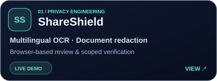
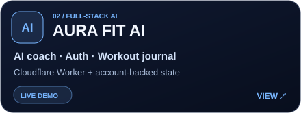
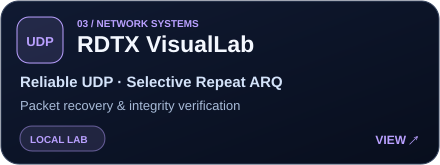
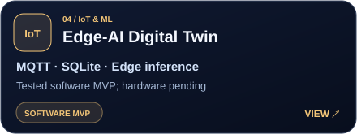
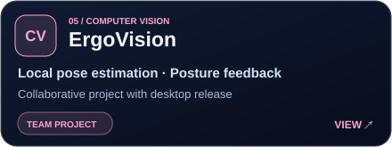
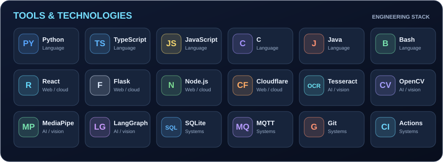
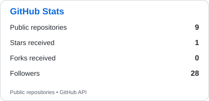
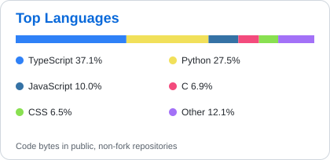
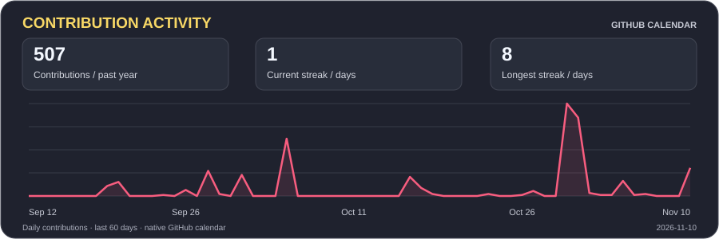

  

**AI & Full-Stack Developer · Computer Science · Systems Engineering**

[**Portfolio ↗**](https://krutharth-portfolio.krutharth-dev.workers.dev/) &nbsp; · &nbsp; [**Engineering case studies ↗**](https://krutharth-portfolio.krutharth-dev.workers.dev/case-studies.html) &nbsp; · &nbsp; [**Resume ↗**](https://krutharth-portfolio.krutharth-dev.workers.dev/resume.html)

Building thoughtful software at the intersection of AI, privacy, product engineering and reliable systems.

---

## 01 / About & current focus

I build practical AI applications and the systems behind them — from document redaction and full-stack coaching to reliable network protocols and edge telemetry. My approach is to make the architecture understandable, the software testable and the limitations explicit.

- **Applied AI:** multilingual document intelligence, safety-aware agents and computer vision.
- **Full-stack engineering:** React, TypeScript, Python, cloud deployments, authenticated state and automated testing.
- **Systems:** reliable transport, MQTT telemetry, SQLite and edge computing.

🏆 **Signal Quest — Third place** · [Competition announcement ↗](https://www.instagram.com/p/Dd9Exx5EtT-/)

---

## 02 / Featured engineering projects

<table>
  <tr><td width="50%" valign="top"> <strong>ShareShield</strong> · <a href="https://shareshield-mini.pages.dev/">Live demo</a> · <a href="https://krutharth-portfolio.krutharth-dev.workers.dev/case-studies.html#shareshield">Case study</a></td><td width="50%" valign="top"> <strong>AURA FIT AI</strong> · <a href="https://aura-fit-ai.krutharth-dev.workers.dev/">Live demo</a> · <a href="https://krutharth-portfolio.krutharth-dev.workers.dev/case-studies.html#aura-fit">Case study</a></td></tr>
  <tr><td width="50%" valign="top"> <strong>RDTX VisualLab</strong> · <a href="https://github.com/krutharth-dev/RDTX-Reliable-UDP-Transfer/blob/main/docs/DEMO_GUIDE.md">Demo guide</a> · <a href="https://krutharth-portfolio.krutharth-dev.workers.dev/case-studies.html#rdtx">Case study</a></td><td width="50%" valign="top"> <strong>Edge-AI Digital Twin</strong> · <a href="https://github.com/krutharth-dev/edge-ai-digital-twin/blob/main/docs/MAC_RUNBOOK.md">Demo guide</a> · <a href="https://krutharth-portfolio.krutharth-dev.workers.dev/case-studies.html#digital-twin">Case study</a></td></tr>
  <tr><td width="50%" valign="top"> <strong>ErgoVision</strong> · <a href="https://github.com/mjkr-1/Ergo-Vision/releases/tag/v1.1.0">Release</a> · <a href="https://krutharth-portfolio.krutharth-dev.workers.dev/case-studies.html#ergovision">Case study</a></td><td width="50%" valign="top"><h3>Explore the engineering</h3>
Five case studies covering problems, architecture, design decisions, verification and current project status.

<a href="https://krutharth-portfolio.krutharth-dev.workers.dev/case-studies.html"><strong>View all case studies ↗</strong></a>

<a href="https://github.com/krutharth-dev?tab=repositories">All repositories ↗</a>
</td></tr>
</table>

Project cards are original illustrative graphics, not application screenshots. Team projects are credited in their repositories; software prototypes and validation limits are identified explicitly.

<strong>Explore technical demos and project evidence</strong>

- [ShareShield](https://github.com/krutharth-dev/ShareShield) — [Known limitations](https://github.com/krutharth-dev/ShareShield/blob/main/docs/KNOWN_LIMITATIONS.md) · [Redaction demo](https://shareshield-mini.pages.dev/)
- [AURA FIT AI](https://github.com/krutharth-dev/aura-fit-ai) — [Automated checks](https://github.com/krutharth-dev/aura-fit-ai/actions/workflows/ci.yml) · [Illustrated coach preview](https://github.com/krutharth-dev/aura-fit-ai/blob/main/docs/media/coach-preview.svg)
- [RDTX VisualLab](https://github.com/krutharth-dev/RDTX-Reliable-UDP-Transfer) — [Protocol](https://github.com/krutharth-dev/RDTX-Reliable-UDP-Transfer/blob/main/docs/PROTOCOL.md) · [Reproducibility](https://github.com/krutharth-dev/RDTX-Reliable-UDP-Transfer/blob/main/docs/REPRODUCIBILITY.md)
- [Edge-AI Digital Twin](https://github.com/krutharth-dev/edge-ai-digital-twin) — [Implementation status](https://github.com/krutharth-dev/edge-ai-digital-twin/blob/main/docs/IMPLEMENTATION_STATUS.md)
- [ErgoVision](https://github.com/mjkr-1/Ergo-Vision) — [Privacy documentation](https://github.com/mjkr-1/Ergo-Vision/blob/main/docs/PRIVACY.md)

---

## 03 / Tools & technologies

  

Additional foundations: [Operating systems in C](https://github.com/krutharth-dev/os-algorithms-simulator-c) · [Unix and Bash](https://github.com/krutharth-dev/unix-mini-projects) · [Java inventory management](https://github.com/krutharth-dev/inventory-management-system-java).

---

## 04 / GitHub stats & activity

  <picture>
    <source media="(prefers-color-scheme: dark)" srcset="assets/profile-stats-dark.svg" />
    
  </picture>
  <picture>
    <source media="(prefers-color-scheme: dark)" srcset="assets/top-languages-dark.svg" />
    
  </picture>

   

  

  Repository statistics and the contribution dashboard refresh through <a href="https://github.com/krutharth-dev/krutharth-dev/actions/workflows/profile-cards.yml">GitHub Actions</a>. All metrics use GitHub data; language percentages reflect public, non-fork repositories.

### Contribution animation

<picture>
  <source media="(prefers-color-scheme: dark)" srcset="https://raw.githubusercontent.com/krutharth-dev/krutharth-dev/output/github-contribution-grid-snake-dark.svg" />
  <source media="(prefers-color-scheme: light)" srcset="https://raw.githubusercontent.com/krutharth-dev/krutharth-dev/output/github-contribution-grid-snake.svg" />
  
</picture>

Generated by <a href="https://github.com/krutharth-dev/krutharth-dev/blob/main/.github/workflows/snake.yml">GitHub Actions</a>.

---

## 05 / Engineering principles

| Practice | Evidence |
| :-- | :-- |
| **Test before shipping** | [AURA FIT checks](https://github.com/krutharth-dev/aura-fit-ai/actions/workflows/ci.yml) · [RDTX multi-version tests](https://github.com/krutharth-dev/RDTX-Reliable-UDP-Transfer/actions/workflows/tests.yml) |
| **Build for privacy** | [ShareShield verification boundaries](https://github.com/krutharth-dev/ShareShield/blob/main/docs/KNOWN_LIMITATIONS.md) · [ErgoVision local processing](https://github.com/mjkr-1/Ergo-Vision/blob/main/docs/PRIVACY.md) |
| **Make results reproducible** | [RDTX experiments, seeds and metrics](https://github.com/krutharth-dev/RDTX-Reliable-UDP-Transfer/blob/main/docs/REPRODUCIBILITY.md) |
| **Be explicit about limitations** | [Digital Twin implementation status](https://github.com/krutharth-dev/edge-ai-digital-twin/blob/main/docs/IMPLEMENTATION_STATUS.md) · [AURA FIT security boundaries](https://github.com/krutharth-dev/aura-fit-ai/blob/main/SECURITY.md) |

---

### Let's build something meaningful.

[**Portfolio**](https://krutharth-portfolio.krutharth-dev.workers.dev/) · [**GitHub repositories**](https://github.com/krutharth-dev?tab=repositories) · [**Technical resume**](https://krutharth-portfolio.krutharth-dev.workers.dev/resume.html)

Build thoughtfully. Test carefully. Keep learning.

