# Krutharth Prashanth Gowda

**AI & Full-Stack Developer · Privacy Engineering · Reliable Systems**

Building intelligent applications, privacy-focused software and reliable systems.

[**Portfolio & case studies**](https://krutharth-portfolio.krutharth-dev.workers.dev/) · [**Technical resume**](https://krutharth-portfolio.krutharth-dev.workers.dev/resume.html) · [**Repositories**](https://github.com/krutharth-dev?tab=repositories)

<picture>
  <source media="(max-width: 600px)" srcset="https://raw.githubusercontent.com/krutharth-dev/krutharth-dev/main/assets/hero-terminal-mobile.svg" />
  
</picture>

Computer science · Applied AI · Full-stack engineering · Systems & networks

---

## Selected work

Five projects that demonstrate product engineering, system design, testing and technical depth.

| Project | What it demonstrates | Status & evidence |
| :-- | :-- | :-- |
| **[ShareShield](https://github.com/krutharth-dev/ShareShield)** | Multilingual document OCR, sensitive-data detection, review, redaction and scoped export verification. | [Live demo](https://shareshield-mini.pages.dev/) · [Known limitations](https://github.com/krutharth-dev/ShareShield/blob/main/docs/KNOWN_LIMITATIONS.md) |
| **[AURA FIT AI](https://github.com/krutharth-dev/aura-fit-ai)** | Safety-aware AI coaching, authenticated accounts, training journal and cloud-backed state. | [Live demo](https://aura-fit-ai.krutharth-dev.workers.dev/) · [CI](https://github.com/krutharth-dev/aura-fit-ai/actions/workflows/ci.yml) |
| **[RDTX VisualLab](https://github.com/krutharth-dev/RDTX-Reliable-UDP-Transfer)** | Reliable UDP file transfer using Selective Repeat ARQ, live telemetry and reproducible network experiments. | [Local demo](https://github.com/krutharth-dev/RDTX-Reliable-UDP-Transfer/blob/main/docs/DEMO_GUIDE.md) · [Protocol](https://github.com/krutharth-dev/RDTX-Reliable-UDP-Transfer/blob/main/docs/PROTOCOL.md) |
| **[Edge-AI Digital Twin](https://github.com/krutharth-dev/edge-ai-digital-twin)** | MQTT telemetry, SQLite, condition monitoring and optional ML fault classification. | Tested software MVP; hardware validation pending · [Status](https://github.com/krutharth-dev/edge-ai-digital-twin/blob/main/docs/IMPLEMENTATION_STATUS.md) |
| **[ErgoVision](https://github.com/mjkr-1/Ergo-Vision)** | Collaborative computer vision application with local webcam processing and posture feedback. | [Desktop release](https://github.com/mjkr-1/Ergo-Vision/releases/tag/v1.1.0) · [Privacy](https://github.com/mjkr-1/Ergo-Vision/blob/main/docs/PRIVACY.md) |

### Featured project — ShareShield

**Privacy-aware document intelligence.** Browser-based OCR and document review help users identify, prioritize and redact sensitive information. The application distinguishes uncertain findings from verified scoped results rather than claiming universal anonymization.

**Architecture:** Document → OCR → candidate review → redaction → downloaded-file verification.

**Engineering focus:** multilingual recognition, confidence handling, duplicate OCR observations, privacy boundaries and regression testing. Kannada accuracy and real-document acceptance testing remain ongoing.

[Explore source](https://github.com/krutharth-dev/ShareShield) · [Try the demo](https://shareshield-mini.pages.dev/) · [Read the technical case study](https://krutharth-portfolio.krutharth-dev.workers.dev/#projects)

### Project previews

<strong>AURA FIT AI — illustrated interface preview</strong>

[Demo walkthrough](https://github.com/krutharth-dev/aura-fit-ai/blob/main/DEMO_GUIDE.md)

<strong>RDTX VisualLab — illustrated protocol walkthrough</strong>

[Reproduce the demo](https://github.com/krutharth-dev/RDTX-Reliable-UDP-Transfer/blob/main/docs/SHORT_DEMO.md)

### Systems foundations

[OS Algorithms Simulator (C)](https://github.com/krutharth-dev/os-algorithms-simulator-c) · [Unix Mini Projects (Bash)](https://github.com/krutharth-dev/unix-mini-projects) · [Java Inventory Management](https://github.com/krutharth-dev/inventory-management-system-java)

---

## Engineering toolkit

| Area | Technologies |
| :-- | :-- |
| Languages | Python · TypeScript · JavaScript · C · Java · Bash |
| Web & cloud | React · Flask · Cloudflare Workers/D1 · Node.js |
| AI & computer vision | Tesseract OCR · OpenCV · MediaPipe · LangGraph |
| Systems & tooling | UDP · MQTT · SQLite · Linux · Git · GitHub Actions |

## How I build

- **Testing:** [AURA FIT lint, types and automated tests](https://github.com/krutharth-dev/aura-fit-ai/blob/main/.github/workflows/ci.yml), [RDTX multi-version protocol tests](https://github.com/krutharth-dev/RDTX-Reliable-UDP-Transfer/blob/main/.github/workflows/tests.yml), and [Digital Twin software CI](https://github.com/krutharth-dev/edge-ai-digital-twin/actions/workflows/software-tests.yml).
- **Privacy and safety:** [ShareShield's documented verification limitations](https://github.com/krutharth-dev/ShareShield/blob/main/docs/KNOWN_LIMITATIONS.md), [AURA FIT security boundaries](https://github.com/krutharth-dev/aura-fit-ai/blob/main/SECURITY.md), and [ErgoVision local processing](https://github.com/mjkr-1/Ergo-Vision/blob/main/docs/PRIVACY.md).
- **Reproducibility:** [RDTX experimental methodology](https://github.com/krutharth-dev/RDTX-Reliable-UDP-Transfer/blob/main/docs/REPRODUCIBILITY.md) records settings, seeds and measured outcomes.
- **Collaboration:** Project repositories document team attribution, implementation status and technical decisions. I use issues and pull request reviews to track improvements.

## Recognition

**Signal Quest — Third place.** [Competition announcement](https://www.instagram.com/p/Dd9Exx5EtT-/)

---

## GitHub activity

<picture>
  <source media="(prefers-color-scheme: dark)" srcset="assets/profile-stats-dark.svg" />
  
</picture>
<picture>
  <source media="(prefers-color-scheme: dark)" srcset="assets/top-languages-dark.svg" />
  
</picture>

 

Stats cards are generated daily using GitHub Actions and public GitHub API data. You can always view the <a href="https://github.com/krutharth-dev?tab=overview">native contribution history</a> and <a href="https://github.com/krutharth-dev?tab=repositories">repositories</a> directly on GitHub.

## Contributions

<picture>
  <source media="(prefers-color-scheme: dark)" srcset="https://raw.githubusercontent.com/krutharth-dev/krutharth-dev/output/github-contribution-grid-snake-dark.svg" />
  <source media="(prefers-color-scheme: light)" srcset="https://raw.githubusercontent.com/krutharth-dev/krutharth-dev/output/github-contribution-grid-snake.svg" />
  
</picture>

Generated by <a href="https://github.com/krutharth-dev/krutharth-dev/blob/main/.github/workflows/snake.yml">GitHub Actions</a>.

---

## Contact & collaboration

Explore the [portfolio](https://krutharth-portfolio.krutharth-dev.workers.dev/), browse the source, or open a relevant issue in a project repository.

Build thoughtfully. Test carefully. Keep learning.

