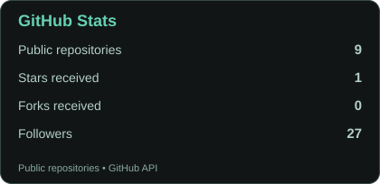
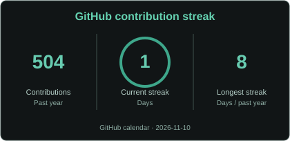
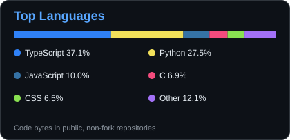
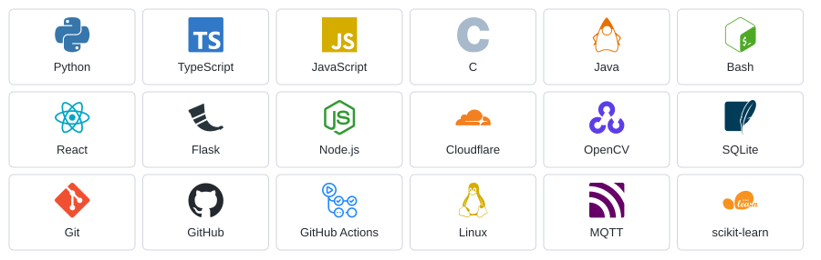

# Hi there, I'm Krutharth 👋

  

  
  
  

---

## 📊 GitHub Stats

  
  

  

## 📈 Contribution Graph

  

Profile statistics, language breakdown, streaks and activity use GitHub data and are refreshed automatically. Language percentages represent public, non-fork repository code.

---

## 🛠️ My Favorite Tools & Technologies

  

Technology icons from <a href="https://simpleicons.org/">Simple Icons</a>. I use these tools across my software, networking, AI and systems projects.

---

## 🚀 Featured Projects

| Project | What I'm building | Explore |
| :-- | :-- | :-- |
| **[ShareShield](https://github.com/krutharth-dev/ShareShield)** | Privacy-focused document redaction with multilingual OCR and reviewable export verification. | [Live demo](https://shareshield-mini.pages.dev/) · [Case study](https://krutharth-portfolio.krutharth-dev.workers.dev/case-studies.html#shareshield) |
| **[AURA FIT AI](https://github.com/krutharth-dev/aura-fit-ai)** | AI coaching, authenticated accounts and cloud-backed workout history. | [Live demo](https://aura-fit-ai.krutharth-dev.workers.dev/) · [Case study](https://krutharth-portfolio.krutharth-dev.workers.dev/case-studies.html#aura-fit) |
| **[RDTX VisualLab](https://github.com/krutharth-dev/RDTX-Reliable-UDP-Transfer)** | Reliable UDP transport with selective-repeat ARQ and reproducible network experiments. | [Demo guide](https://github.com/krutharth-dev/RDTX-Reliable-UDP-Transfer/blob/main/docs/DEMO_GUIDE.md) |
| **[Edge-AI Digital Twin](https://github.com/krutharth-dev/edge-ai-digital-twin)** | MQTT telemetry, edge inference and stateful monitoring; hardware validation pending. | [Demo guide](https://github.com/krutharth-dev/edge-ai-digital-twin/blob/main/docs/MAC_RUNBOOK.md) |
| **[ErgoVision](https://github.com/mjkr-1/Ergo-Vision)** | Team project: local posture tracking and privacy-aware computer vision. | [Release](https://github.com/mjkr-1/Ergo-Vision/releases/tag/v1.1.0) |

<a href="https://krutharth-portfolio.krutharth-dev.workers.dev/case-studies.html"><strong>Explore all engineering case studies →</strong></a>

## 🏆 Achievements & Interests

- **Signal Quest — Third place** · [Competition announcement](https://www.instagram.com/p/Dd9Exx5EtT-/)
- **Currently exploring:** Edge AI, multilingual document intelligence, privacy-aware applications and networked systems.
- **Engineering focus:** Automated testing, reproducible experiments, transparent limitations and real-world usability.

<strong>Project evidence and engineering notes</strong>

- ShareShield: [Known limitations](https://github.com/krutharth-dev/ShareShield/blob/main/docs/KNOWN_LIMITATIONS.md)
- AURA FIT AI: [Automated checks](https://github.com/krutharth-dev/aura-fit-ai/actions/workflows/ci.yml)
- RDTX VisualLab: [Protocol](https://github.com/krutharth-dev/RDTX-Reliable-UDP-Transfer/blob/main/docs/PROTOCOL.md) · [Reproducibility](https://github.com/krutharth-dev/RDTX-Reliable-UDP-Transfer/blob/main/docs/REPRODUCIBILITY.md)
- Edge-AI Digital Twin: [Implementation status](https://github.com/krutharth-dev/edge-ai-digital-twin/blob/main/docs/IMPLEMENTATION_STATUS.md)
- ErgoVision: [Privacy documentation](https://github.com/mjkr-1/Ergo-Vision/blob/main/docs/PRIVACY.md)

---

## 🐍 Contribution Snake

  <picture>
    <source media="(prefers-color-scheme: dark)" srcset="https://raw.githubusercontent.com/krutharth-dev/krutharth-dev/output/github-contribution-grid-snake-dark.svg" />
    <source media="(prefers-color-scheme: light)" srcset="https://raw.githubusercontent.com/krutharth-dev/krutharth-dev/output/github-contribution-grid-snake.svg" />
    
  </picture>

---

### Let's build something meaningful.

[**Portfolio**](https://krutharth-portfolio.krutharth-dev.workers.dev/) · [**Repositories**](https://github.com/krutharth-dev?tab=repositories) · [**Resume**](https://krutharth-portfolio.krutharth-dev.workers.dev/resume.html)

